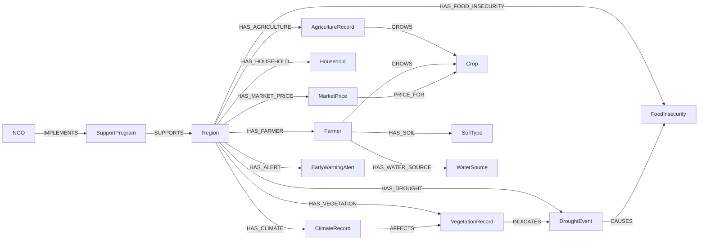

# A-Neo4j-Based-Knowledge-Graph-for-Drought-and-Food-Insecurity-Early-Warning-system
Knowledge Graph-Based Drought and Food Insecurity Early Warning System

# DroughtKG: A Neo4j Knowledge Graph for Drought and Food Insecurity Early Warning


A property-graph knowledge graph that integrates **15 heterogeneous datasets** (climate, vegetation, agriculture, drought events, food insecurity, households, farmers, crops, soil, water, markets, NGOs, support programs and early warning alerts) into one queryable Neo4j database. It supports graph traversal, visualization, rule-based reasoning along the chain **Climate -> Vegetation -> Drought -> Food Insecurity**, and decision-support queries such as identifying high-risk regions and the NGO programs that cover them.

> MSc in Data Science project, Haramaya University (College of Computing and Informatics, Department of Information Science), June 2026.
> Author: **Bona Nasser** | Instructor: Tamrat D. (PhD)


---

## Table of Contents

- [Motivation](#motivation)
- [Key Features](#key-features)
- [Graph Model](#graph-model)
- [Datasets](#datasets)
- [Repository Structure](#repository-structure)
- [Getting Started](#getting-started)
- [Example Queries](#example-queries)
- [Visualizations](#visualizations)
- [Graph Statistics](#graph-statistics)
- [Known Limitations](#known-limitations)
- [Future Work](#future-work)
- [References](#references)
- [Citation](#citation)
- [License](#license)

---

## Motivation

Drought and food insecurity data are scattered across climate stations, remote-sensing products, agricultural surveys, market monitors and humanitarian agencies, each in its own format and schema. Answering cross-domain questions in a relational database means many joins and rigid schemas. A knowledge graph represents the entities and their relationships directly, so questions like these become short traversals:

- Which regions experience severe drought **and** high food insecurity at the same time?
- How do rainfall and temperature relate to vegetation condition (NDVI) and drought severity?
- Which crops and farmers are in vulnerable regions?
- Which NGOs and support programs currently cover the most affected regions?
- Which regions need an early warning alert?

## Key Features

- **15 node labels** and **18 relationship types** modelled in Neo4j's property graph
- **Repeatable build:** one Cypher script creates constraints, indexes, nodes and relationships from CSV files
- **Reasoning chain** `ClimateRecord -> VegetationRecord -> DroughtEvent -> FoodInsecurity` for tracing how climate conditions propagate to food insecurity
- **Decision-support queries:** drought and IPC-phase hot spots, NGO coverage, crop and farmer distribution, composite drought risk score, household vulnerability index
- **Graph analytics:** degree centrality of regions, data-completeness checks
- **Ready-made visualization queries** for Neo4j Browser

## Graph Model



The schema as rendered by `CALL db.schema.visualization()`:


### Relationship semantics

| Relationship | Pattern | Meaning |
|---|---|---|
| `HAS_CLIMATE`, `HAS_VEGETATION`, `HAS_AGRICULTURE`, `HAS_DROUGHT`, `HAS_FOOD_INSECURITY`, `HAS_HOUSEHOLD`, `HAS_FARMER`, `HAS_MARKET_PRICE`, `HAS_ALERT` | Region -> record | Region owns the record (joined on `region_id`) |
| `GROWS` | AgricultureRecord / Farmer -> Crop | Crop grown or recorded |
| `PRICE_FOR` | MarketPrice -> Crop | Price refers to a crop |
| `HAS_SOIL`, `HAS_WATER_SOURCE` | Farmer -> SoilType / WaterSource | Farm conditions |
| `IMPLEMENTS` | NGO -> SupportProgram | NGO runs a program |
| `SUPPORTS` | SupportProgram -> Region | Program covers a region |
| `AFFECTS` | ClimateRecord -> VegetationRecord | Same region and year |
| `INDICATES` | VegetationRecord -> DroughtEvent | Same region and year |
| `CAUSES` | DroughtEvent -> FoodInsecurity | Same region and year |

## Datasets

Fifteen CSV files, one per node label. Keys such as `region_id`, `crop_id`, `soil_id`, `water_id`, `ngo_id` and `program_id` link them.

<!-- TODO (author): add data provenance here - how/where each CSV was obtained or generated, time span, and licence. -->

| File | Node label | Rows | Main properties |
|---|---|---|---|
| `regions.csv` | `Region` | 20 | `region_id`, `name`, `zone`, `population` |
| `climate_records.csv` | `ClimateRecord` | 100 | `year`, `rainfall_mm`, `temperature_c`, `humidity` |
| `vegetation_records.csv` | `VegetationRecord` | 100 | `year`, `ndvi`, `status` |
| `agriculture_records.csv` | `AgricultureRecord` | 100 | `year`, `crop_id`, `yield_ton` |
| `drought_events.csv` | `DroughtEvent` | 50 | `year`, `severity`, `duration_months` |
| `food_insecurity.csv` | `FoodInsecurity` | 50 | `year`, `ipc_phase`, `affected_population` |
| `households.csv` | `Household` | 100 | `size`, `income_level` |
| `farmers.csv` | `Farmer` | 100 | `name`, `age`, `crop_id`, `soil_id`, `water_id` |
| `crops.csv` | `Crop` | 5 | `crop_name` |
| `soil_types.csv` | `SoilType` | 4 | `soil_name` |
| `water_resources.csv` | `WaterSource` | 50 | `source_type` |
| `market_prices.csv` | `MarketPrice` | 100 | `year`, `crop_id`, `price` |
| `ngos.csv` | `NGO` | 5 | `name` |
| `support_programs.csv` | `SupportProgram` | 30 | `ngo_id`, `region_id`, `program_name`, `budget` |
| `early_warning_alerting.csv` | `EarlyWarningAlert` | 80 | `year`, `risk_level` |

## Repository Structure

The import script loads the CSVs directly from this repository's `main` branch, so the CSV files must stay at the repository root (or the URLs in the script must be updated).

```
DroughtKG/
├── README.md
├── regions.csv
├── climate_records.csv
├── vegetation_records.csv
├── agriculture_records.csv
├── drought_events.csv
├── food_insecurity.csv
├── households.csv
├── farmers.csv
├── crops.csv
├── soil_types.csv
├── water_resources.csv
├── market_prices.csv
├── ngos.csv
├── support_programs.csv
├── early_warning_alerting.csv
├── cypher/
│   └── drought_kg.cypher          # full build + query script (report appendix)
├── docs/
│   └── project_report.docx        # full project report
└── images/                        # Neo4j Browser screenshots used below
```

## Getting Started

### Prerequisites

- [Neo4j Desktop](https://neo4j.com/download/) with a **Neo4j 5.x** database (the script was run against `neo4j://127.0.0.1:7687`)
- Internet access for `LOAD CSV` from GitHub raw URLs (or copy the CSVs into the database's `import` folder and switch to `file:///` URLs)

### Build the graph

1. Create and start a new, **empty** Neo4j 5.x database and open **Neo4j Browser**.
2. Open `cypher/drought_kg.cypher` and run it phase by phase:

   | Phase | What it does |
   |---|---|
   | 1 | Uniqueness constraints (15) and indexes (7) |
   | 2 | `LOAD CSV` of the 15 datasets into nodes (`MERGE`) |
   | 3 | Creation of the 18 relationship types |
   | 4 | Verification queries (counts, schema, completeness) |
   | 5 | Analytical / decision-support queries |
   | 6 | Visualization queries |

3. Confirm the build with the verification queries:

   ```cypher
   MATCH (n) RETURN count(n) AS TotalNodes;                 // expected: 894
   MATCH ()-[r]->() RETURN count(r) AS TotalRelationships;  // expected: 1474
   ```

> **Warning:** Phase 1 begins with `MATCH (n) DETACH DELETE n;`, which deletes everything in the current database. Use a dedicated database.

## Example Queries

**Full reasoning chain (visualize in Neo4j Browser)**

```cypher
MATCH p=(r:Region)-[:HAS_CLIMATE]->(c:ClimateRecord)
        -[:AFFECTS]->(v:VegetationRecord)
        -[:INDICATES]->(d:DroughtEvent)
        -[:CAUSES]->(f:FoodInsecurity)
RETURN p
LIMIT 20;
```

**Regions with high drought, high food insecurity (IPC phase 4+) and an alert**

```cypher
MATCH (r:Region)-[:HAS_DROUGHT]->(d:DroughtEvent)
MATCH (r)-[:HAS_FOOD_INSECURITY]->(f:FoodInsecurity)
MATCH (r)-[:HAS_ALERT]->(a:EarlyWarningAlert)
WHERE d.severity = 'High' AND f.ipc_phase >= 4
RETURN r.name, d.severity, f.ipc_phase, a.risk_level;
```

**NGO programs working in high-drought regions**

```cypher
MATCH (n:NGO)-[:IMPLEMENTS]->(p:SupportProgram)-[:SUPPORTS]->(r:Region)
MATCH (r)-[:HAS_DROUGHT]->(d:DroughtEvent)
WHERE d.severity = 'High'
RETURN r.name, n.name, p.program_name;
```

**Farmers per crop**

```cypher
MATCH (f:Farmer)-[:GROWS]->(c:Crop)
RETURN c.crop_name, count(f) AS FarmersGrowing
ORDER BY FarmersGrowing DESC;
```

### Composite drought risk score (query 5.23)

For each region in 2024, four indicators are scored 0-25 and summed to a 0-100 score:

| Indicator | Scoring |
|---|---|
| Rainfall (`rainfall_mm`) | < 200: 25, < 300: 18, < 400: 10, else 0 |
| Vegetation (`ndvi`) | < 0.2: 25, < 0.35: 18, < 0.5: 10, else 0 |
| Drought severity | Extreme: 25, Severe: 18, High: 12, Moderate: 6 |
| IPC phase | 5+: 25, 4: 18, 3: 10, else 0 |

Total >= 75 is `CRITICAL`, >= 50 `HIGH`, >= 25 `MODERATE`, otherwise `LOW`. The thresholds are illustrative and are not calibrated against observed outcomes.

The script also contains a household vulnerability index, degree centrality, an alert-by-year summary, and a rule-based "2026 outlook" query. See Phases 4 to 6 of `cypher/drought_kg.cypher`.

## Visualizations

All screenshots come from Neo4j Browser.

**Semantic reasoning chain.** Several climate records affect a vegetation record (label shows its NDVI), which indicates a drought event that causes a food-insecurity record.


**Reasoning paths for individual regions** (Shinile and Dire Dawa).

 


**NGO -> SupportProgram -> Region** coverage (CARE and FAO shown).

 


**Region -> AgricultureRecord -> Crop** network.

 


**A single region and its connections** (West Arsi).


## Graph Statistics

**Nodes (894 total)**

| Label | Count | Label | Count |
|---|---|---|---|
| ClimateRecord | 100 | SupportProgram | 30 |
| VegetationRecord | 100 | Region | 20 |
| AgricultureRecord | 100 | Crop | 5 |
| Household | 100 | NGO | 5 |
| Farmer | 100 | SoilType | 4 |
| MarketPrice | 100 | DroughtEvent | 50 |
| EarlyWarningAlert | 80 | FoodInsecurity | 50 |
| WaterSource | 50 | | |

**Relationships (1,474 total)**

| Type | Count | Type | Count |
|---|---|---|---|
| GROWS | 200 | HAS_SOIL | 100 |
| HAS_AGRICULTURE | 100 | HAS_VEGETATION | 100 |
| HAS_CLIMATE | 100 | HAS_WATER_SOURCE | 100 |
| HAS_FARMER | 100 | PRICE_FOR | 100 |
| HAS_HOUSEHOLD | 100 | HAS_ALERT | 80 |
| HAS_MARKET_PRICE | 100 | AFFECTS | 77 |
| HAS_DROUGHT | 50 | INDICATES | 37 |
| HAS_FOOD_INSECURITY | 50 | IMPLEMENTS | 30 |
| SUPPORTS | 30 | CAUSES | 20 |

## Known Limitations

This is a prototype built on a small dataset to demonstrate the approach. Please keep the following in mind:

- **Links in the reasoning chain are joins, not validated causality.** `AFFECTS`, `INDICATES` and `CAUSES` are created by matching region and year. They encode a modelling assumption about the climate -> vegetation -> drought -> food insecurity pathway, and only a subset of records link through (77, 37 and 20 edges respectively).
- **"Reasoning" is traversal plus rules.** There is no RDF/OWL reasoner. Risk scores and the 2026 outlook are hand-set thresholds in Cypher, not a trained or validated forecasting model.
- **Query 5.24 (vegetation trend)** references `c.ndvi_previous`, a property not present in the schema, so every row currently evaluates to `STABLE` until a previous-NDVI value is added.
- **Severity vocabulary differs between queries** (`'High'` in 5.5 and 5.6, `'Severe'`/`'Extreme'` in 5.22 and 5.23). Check the distinct values of `DroughtEvent.severity` and align the queries.
- **Naming:** the script uses `WaterSource` / `HAS_WATER_SOURCE`, while the report text uses "WaterResource". The script is authoritative.
- **Scale:** relationships are created with `MATCH (a),(b) WHERE a.key = b.key`, which is fine at 894 nodes but should be rewritten to use indexed lookups for larger data.
- **No temporal or spatial modelling yet:** years are plain integers and regions have no geometry.

## Future Work

- Ingest real-time satellite, weather-station and IoT sensor data
- Graph machine learning (node embeddings, link prediction) for risk forecasting
- Export to RDF/OWL and query with SPARQL for interoperability with external knowledge bases
- Formal ontology with a reasoner, replacing hand-set rule thresholds
- Dashboard or API on top of the graph for decision-makers

## References

1. FAO et al., *The State of Food Security and Nutrition in the World 2024*, Rome, 2024.
2. IPCC, *Climate Change 2023: Synthesis Report*, Geneva, 2023.
3. A. Hogan et al., "Knowledge Graphs," *ACM Computing Surveys*, vol. 54, no. 4, 2022. [arXiv:2003.02320](https://arxiv.org/abs/2003.02320)
4. Neo4j Inc., [Neo4j Documentation](https://neo4j.com/docs/) and [Cypher Manual](https://neo4j.com/docs/cypher-manual/)
5. I. Robinson, J. Webber and E. Eifrem, *Graph Databases*, 2nd ed., O'Reilly, 2015.
6. FEWS NET Data Center, <https://fews.net> and NASA Earthdata, <https://earthdata.nasa.gov>

The full reference list is in the project report.

## Citation

```bibtex
@misc{nasser2026droughtkg,
  author      = {Nasser, Bona},
  title       = {A Neo4j-Based Knowledge Graph for Drought and Food Insecurity Early Warning Using Climate, Agricultural, Vegetation, and Socioeconomic Data},
  year        = {2026},
  institution = {Haramaya University},
  note        = {MSc in Data Science project report}
}
```

## License

Add a `LICENSE` file (for example MIT for the code and a suitable data licence for the CSVs) to specify reuse terms.

## Acknowledgements

Thanks to Dr. Tamrat D. for supervision and guidance.
images/schema-visualization.png
- images/reasoning-chain.png
- images/reasoning-paths-by-region.png
- images/ngo-programs-regions.png
- images/ngo-support-region-network.png
- images/region-agriculture-crop.png
- images/west-arsi-neighbourhood.png
